# RigDaily

**Sistem pelaporan operasi sumur harian, untuk tim yang bekerja antara rig dan kantor.**

RigDaily mencatat satu hari pengeboran dalam satu layar. Clerk di rig mengisi laporan, Company Man menyetujui dan menandatangani, kantor menerima PDF di pagi hari, dan manajemen melihat angka biaya serta kinerja tanpa menunggu rekap manual.

Dibangun sebagai proyek portofolio dengan arsitektur yang bisa dijalankan di VPS kecil: 2 vCPU, RAM sekitar 2 GB, disk 40 GB.

> **Catatan hukum.** RigDaily adalah karya orisinal. Aplikasi ini tidak memakai source code, aset visual, atau teks milik Infostat Systems maupun IADC. Taksonomi kode operasi disusun sendiri mengikuti pola publik DDR Plus, dengan istilah industri yang memang dipakai bersama: DDR, NPT, POB, AFE, ROP, WOC. RigDaily memakai format **IADC-compatible**, bukan IADC Certified.

---

## Daftar isi

- [Sekilas](#sekilas)
- [Tangkapan layar](#tangkapan-layar)
  - [Masuk](#masuk)
  - [Dashboard](#dashboard)
  - [Operations](#operations)
  - [Well Engineering](#well-engineering)
  - [Drilling Support](#drilling-support)
  - [Analysis](#analysis)
  - [Cost &amp; Billing](#cost--billing)
  - [Documents](#documents)
  - [System](#system)
- [Cara kerja intinya](#cara-kerja-intinya)
- [Menjalankan di komputer sendiri](#menjalankan-di-komputer-sendiri)
- [Menjalankan di VPS 2 vCPU](#menjalankan-di-vps-2-vcpu)
- [Arsitektur](#arsitektur)
- [Aturan domain yang ditegakkan](#aturan-domain-yang-ditegakkan)
- [Peran dan hak akses](#peran-dan-hak-akses)
- [Perintah yang tersedia](#perintah-yang-disiapkan)
- [Data demo](#data-demo)
- [Struktur repositori](#struktur-repositori)
- [Pengujian](#pengujian)
- [Lisensi](#lisensi)

---

## Sekilas

Satu DDR yang selesai memberi banyak keluaran sekaligus: PDF laporan resmi, lembar waktu IADC, komponen biaya, angka NPT, data POB, dan titik data untuk dashboard. Anda mengetik sekali, sistem menurunkan sisanya.

| Aspek | Keterangan |
|---|---|
| Halaman aplikasi | 22 rute |
| Endpoint API | 60 lebih |
| Uji otomatis | 360 unit dan integrasi, 73 end to end |
| Basis data | PostgreSQL 16, dengan PGlite untuk pengembangan tanpa Docker |
| Antarmuka | Next.js 14 App Router, React 18, Tailwind |
| Aplikasi rig | Electron dengan SQLite lokal dan antrean sinkronisasi |
| Deployment | Docker Compose, Caddy untuk TLS otomatis |

Yang membuat sistem ini berguna di lapangan:

1. **Salin laporan kemarin.** Sebagian besar isian DDR tidak berubah antar hari. Copy-forward menghemat mayoritas waktu entri.
2. **Validasi 24 jam otomatis.** Sistem menolak laporan yang total jamnya bukan tepat 1440 menit, atau yang barisnya tumpang tindih.
3. **Satu input, banyak keluaran.** DDR, lembar IADC, biaya, NPT, POB, dan dashboard membaca data yang sama.
4. **Kirim otomatis pagi hari.** Aturan distribusi mengirim PDF ke daftar penerima sesuai jadwal, termasuk saat akhir pekan.
5. **Tetap bisa dipakai tanpa sinyal.** Aplikasi rig menyimpan ke SQLite lokal dan menyinkronkan saat jaringan kembali.
6. **Istilah yang sudah familiar.** DDR, NPT, POB, Company Man, Toolpusher, AFE dipakai apa adanya.
7. **PDF yang bisa langsung diteruskan.** Tata letak formal, hitam putih, siap dikirim ke mitra atau regulator.

---

## Tangkapan layar

Semua gambar diambil pada 1440x900 dengan data demo. Setiap bagian menjelaskan apa yang terlihat dan apa yang bisa dilakukan di sana.

### Masuk

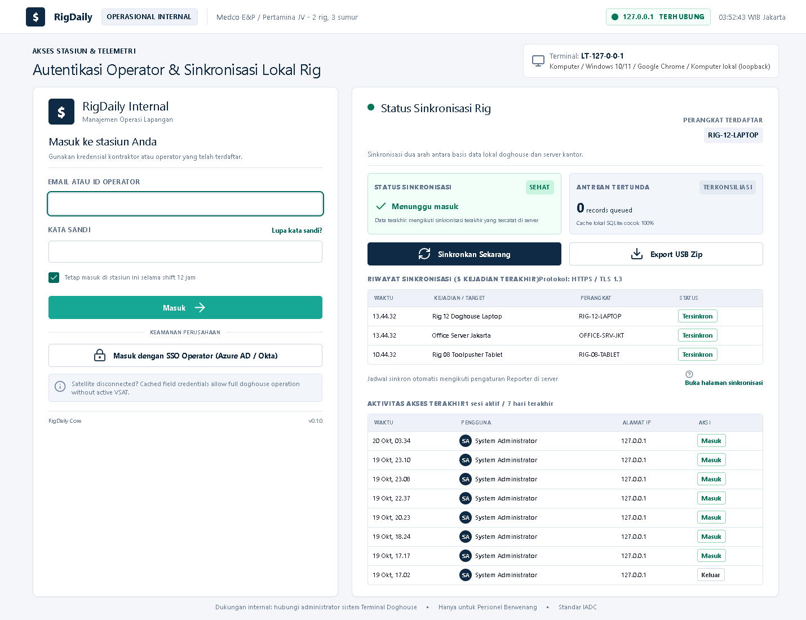

Halaman masuk menampilkan konteks perangkat sebelum Anda menekan tombol apa pun. Alamat IP diambil dari koneksi yang sebenarnya, bukan angka tetap. Jam mengikuti waktu server dalam zona Asia/Jakarta, jadi komputer rig yang jamnya meleset tidak mengacaukan laporan.

Di panel kanan ada dua daftar:

- **Perangkat tersinkron.** Nama perangkat, kode perangkat, waktu terakhir terlihat, dan jumlah perubahan tertunda.
- **Aktivitas akses.** Siapa yang baru masuk atau keluar dalam tujuh hari terakhir. Email disamarkan (`d***@medco-energi.com`) karena halaman ini terbuka sebelum sesi terbentuk.

Gagal masuk lima kali dalam 15 menit akan menahan percobaan berikutnya. Sesi disimpan sebagai cookie HttpOnly yang tidak bisa dibaca JavaScript.

---

### Dashboard

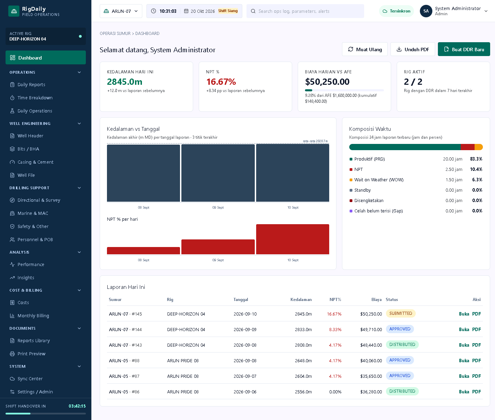

Empat kartu di atas menjawab pertanyaan yang paling sering ditanyakan saat serah terima shift.

| Kartu | Isi | Sumber |
|---|---|---|
| Kedalaman hari ini | Meter akhir, selisih dari kemarin | Laporan terbaru |
| NPT | Persentase waktu tidak produktif dan arah pergerakannya | Ringkasan 24 jam |
| Biaya harian terhadap AFE | Nominal harian dan persentase anggaran terpakai | Baris biaya |
| Rig aktif | Rig yang punya laporan dalam tujuh hari | Master rig |

Grafik batang di bawah menampilkan kedalaman per tanggal dengan garis rata-rata. Batang tumbuh berurutan dari kiri, mengikuti urutan waktu laporan. Donat di sebelahnya memecah 24 jam menjadi waktu produktif, NPT, cuaca, dan sisa tak teralokasi.

Tabel laporan menampilkan lima laporan terakhir beserta statusnya. Klik satu baris untuk membuka DDR-nya.

Pindah sumur lewat pemilih di bilah atas dan seluruh angka ikut berubah. Dashboard per sumur menunjukkan angka sumur itu; tanpa pemilihan sumur, angkanya adalah total seluruh sumur.

---

### Operations

#### Daily Drilling Report

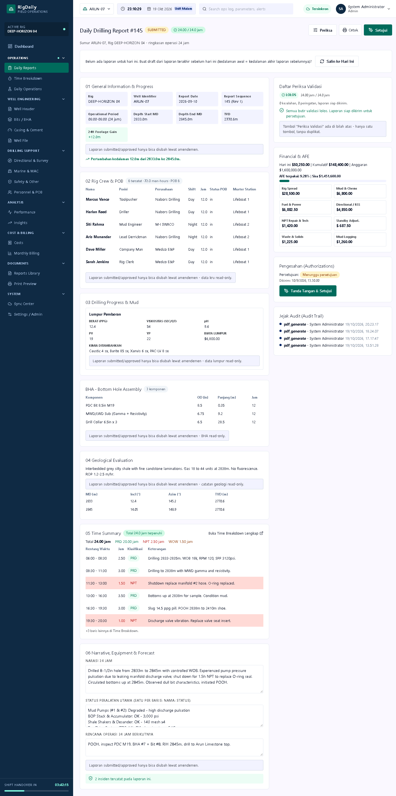

Form DDR disusun dalam enam bagian yang mengikuti kebiasaan pengisian di rig.

1. **General Information.** Rig, sumur, tanggal, nomor laporan, periode 06:00 sampai 06:00, kedalaman awal dan akhir, serta progress 24 jam.
2. **Rig Crew and POB.** Nama, posisi, perusahaan, shift, jam kerja, status keberadaan, dan muster station. Man-hours dihitung langsung saat Anda mengetik.
3. **Drilling Progress and Mud.** Data string, bit, casing shoe, parameter bor, berat lumpur, viskositas, pH, PV/YP, dan bahan kimia yang ditambahkan.
4. **Geology.** Litologi, formation top, indikasi gas, dan catatan wellsit geologist.
5. **Time Summary.** Ringkasan blok waktu dengan tautan ke halaman Time Breakdown.
6. **Narrative, Equipment, Plan.** Narasi operasi, status peralatan utama, rencana 24 jam ke depan, dan tanda tangan penanggung jawab.

Rail kanan menampilkan lima pemeriksaan validasi, ringkasan biaya terhadap AFE, status tanda tangan, dan jejak audit dari laporan itu.

Tombol aksi mengikuti hierarki yang jelas. Satu aksi berwarna sesuai status laporan (Kirim untuk draft, Setujui untuk submitted), aksi pendukung berwarna netral, dan cetak dikelompokkan dalam satu menu dropdown.

Laporan yang sudah disetujui terkunci. Perubahan hanya bisa lewat amendemen, yang membuat revisi bernomor dan mencatat alasannya di jejak audit.

#### Time Breakdown

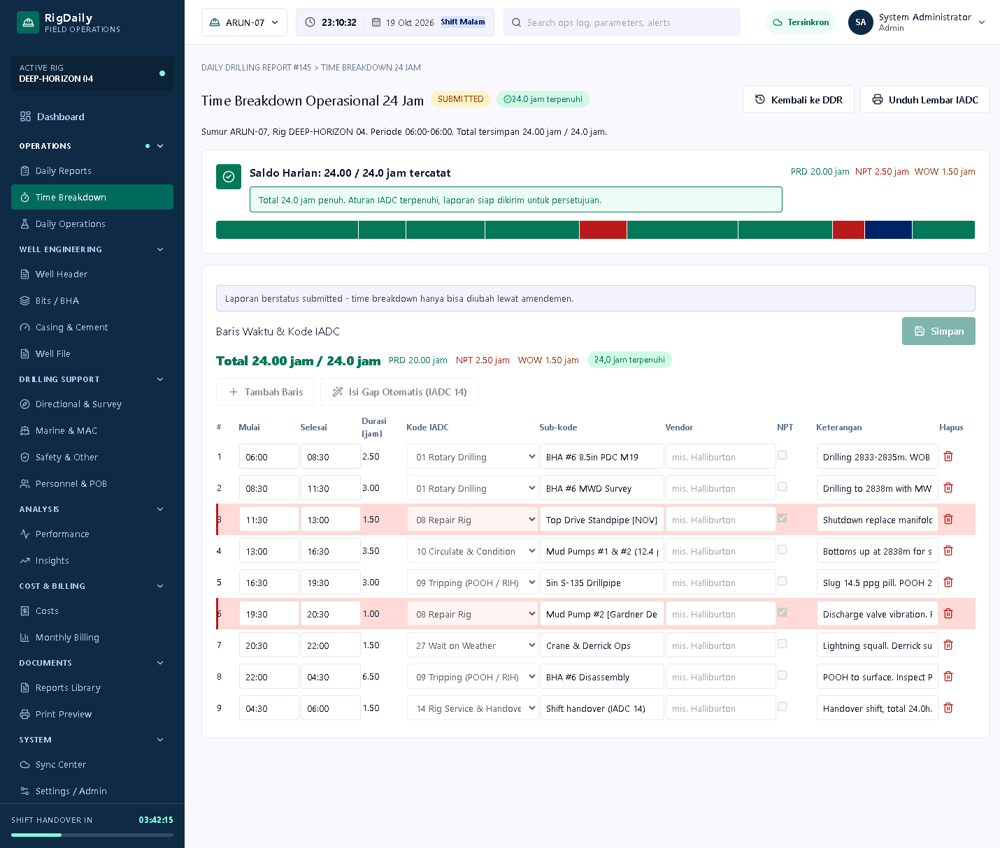

Halaman ini memecah 24 jam menjadi baris berurutan dengan kode IADC.

- Setiap baris punya waktu mulai, waktu selesai, durasi yang dihitung otomatis, kode IADC, sub-kode atau vendor, dan penanda NPT.
- Baris NPT berwarna merah muda dengan garis tepi kiri merah. Baris produktif dibiarkan putih.
- Bilah total di atas menunjukkan `22.5 / 24.0 jam` saat masih kurang, berubah hijau ketika tepat 24 jam.
- Strip linimasa di bawah memperlihatkan sebaran aktivitas sepanjang hari dalam satu garis.

Sistem menolak menyimpan bila total jam bukan 1440 menit, ada baris yang tumpang tindih, atau ada kode yang wajib sub-kode tetapi dibiarkan kosong. Penolakan menyertakan daftar masalah per baris, bukan pesan umum.

Tombol **Isi Gap Otomatis** menambahkan baris handover IADC 14 untuk menutup sisa waktu.

#### Daily Operations

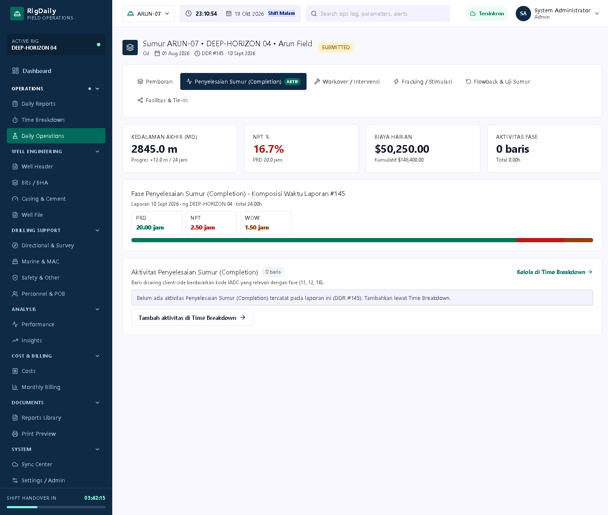

Tab fase mengikuti siklus hidup sumur: Drilling, Completion, Workover, Fracking, Flowback, Facilities.

Setiap fase menyaring baris aktivitas dari laporan terbaru berdasarkan kode IADC yang relevan. Fase Completion menampilkan pekerjaan liner, semen, dan perforasi. Fase Fracking menampilkan kode 31. Fase Flowback menampilkan kode 32.

Bila belum ada aktivitas untuk fase tersebut, halaman mengatakannya dan menawarkan tautan untuk menambah dari Time Breakdown.

---

### Well Engineering

#### Well Header

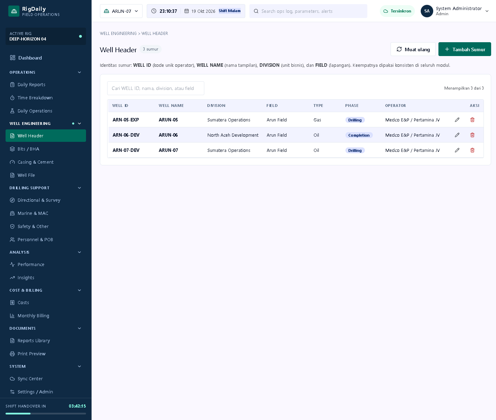

Identitas sumur dikelola di satu tempat.

| Kolom | Isi | Contoh |
|---|---|---|
| WELL ID | Kode unik internal operator | `ARN-07-DEV` |
| WELL NAME | Nama tampilan sumur | `ARUN-07` |
| DIVISION | Unit bisnis pemilik sumur | `Sumatera Operations` |
| FIELD | Lapangan tempat sumur berada | `Arun Field` |

Kolom lain yang bisa diubah: tipe sumur (oil, gas, geothermal, CCS, mining, water), fase, operator, API number, tanggal spud, TD terencana, dan anggaran AFE.

Pengguna dengan izin `master:manage` bisa menambah, mengedit, dan menghapus. Penghapusan bersifat lunak dan tercatat di audit. Sumur yang masih punya laporan harian menolak dihapus.

#### Bits / BHA

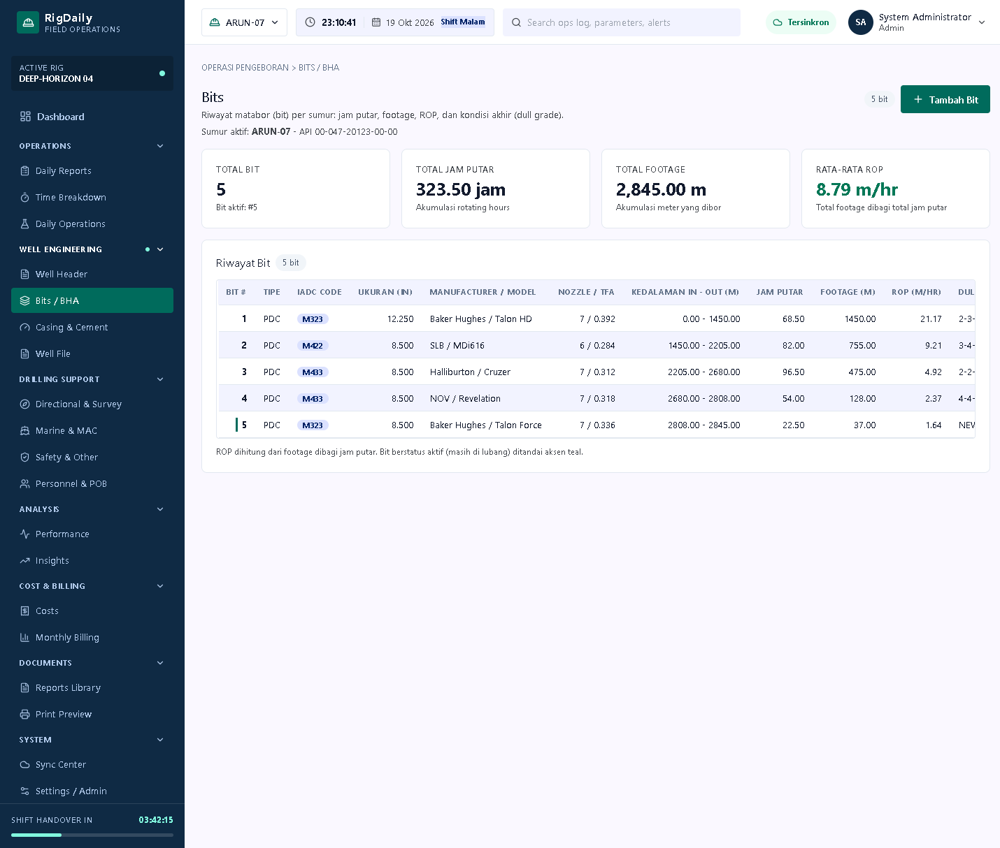

Halaman ini melacak setiap matabor yang dipakai di sumur.

Empat kartu ringkasan di atas menghitung total bit, total jam putar, total footage, dan ROP rata-rata.

Tabel utamanya memuat:

- Nomor bit dan tipe (PDC, tricone, impregnated, core, reamer)
- Kode IADC bit, misalnya `M323`
- Ukuran dalam inci, produsen, model, dan nomor seri
- Jumlah nozzle dan total flow area dalam inci persegi
- Kedalaman masuk dan keluar
- Jam putar, footage, dan ROP yang dihitung dari keduanya
- Dull grade akhir, misalnya `2-3-WT-A-E-I`
- Status: active, pulled, atau available

Bit berstatus aktif ditandai garis teal di kolom nomor. Form tambah bit mengisi nomor bit berikutnya secara otomatis.

#### Casing & Cement

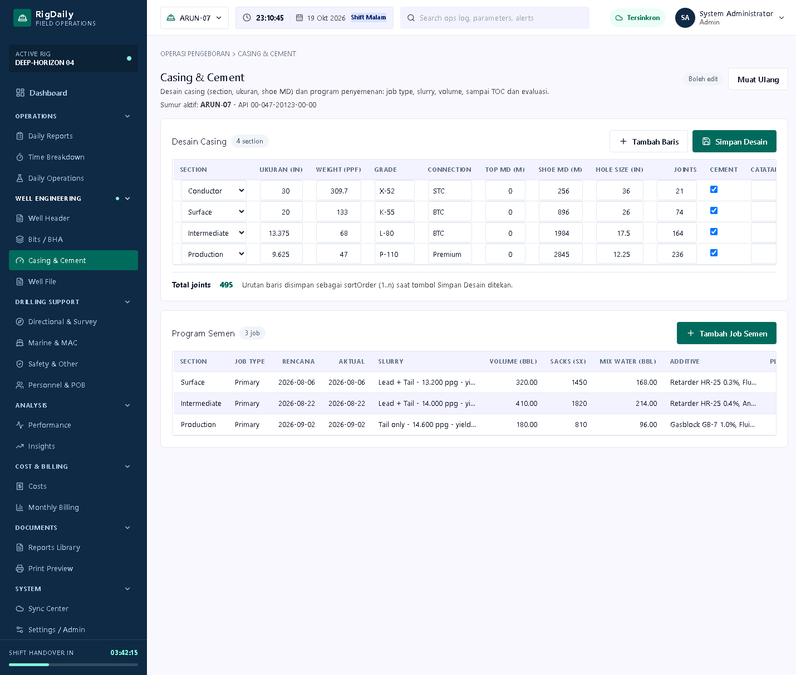

Dua bagian dalam satu halaman.

**Desain casing** berupa tabel yang bisa langsung diedit. Setiap baris berisi section (conductor, surface, intermediate, production, liner), ukuran inci, berat per kaki, grade baja (K-55, L-80, P-110), tipe connection, kedalaman top dan shoe, ukuran lubang bor, jumlah joint, dan penanda apakah section perlu disemen. Total joint tampil di footer.

**Program semen** mencatat setiap pekerjaan penyemenan: section, jenis pekerjaan (primary, squeeze, plug, liner), tanggal rencana dan pelaksanaan, tipe slurry, densitas dalam ppg, yield ft3 per sak, volume, jumlah sak, air pencampur, aditif, tekanan plug bumped, top of cement, hasil evaluasi (good, partial, poor), dan status.

#### Well File

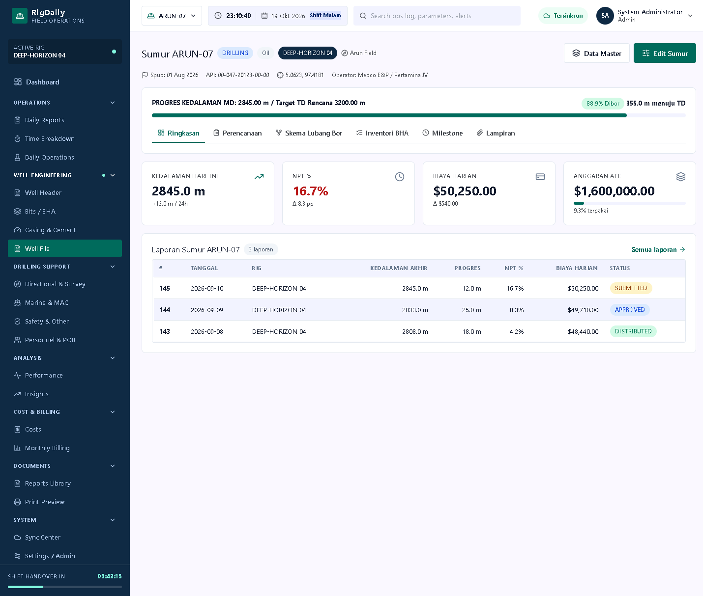

Berkas lengkap satu sumur, dibagi dalam tab.

**Overview** menampilkan KPI dan riwayat laporan. **Planning** memuat target kedalaman, anggaran AFE, dan catatan.

**Borehole Schema** menampilkan penampang lubang bor yang bergerak. Gambarnya memperlihatkan rig di permukaan dengan derrick dan travelling block, casing bertingkat sesuai ukuran inci, drill string yang berputar, bit di kedalaman terakhir, dan partikel cutting yang naik lewat annulus. Setiap tujuh detik siklus berganti dari mengebor menjadi menyambung pipa, seperti ritme kerja sebenarnya.

**Inventory** memuat komponen BHA dari laporan terbaru. **Milestones** menurunkan tonggak dari data yang ada: tanggal spud, laporan terakhir, dan target TD. **Attachments** menyediakan PDF DDR dan lembar IADC.

---

### Drilling Support

#### Safety & Survey

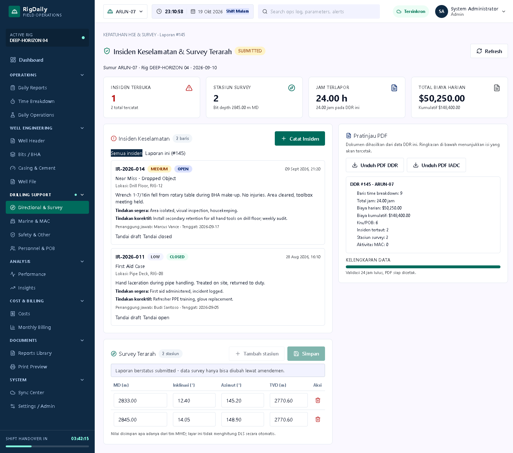

Tiga kartu dalam satu layar.

**Insiden HSE** menampilkan daftar insiden dengan tingkat keparahan berwarna: critical dan high merah, medium amber, low abu-abu. Form pelaporan meminta jenis, tingkat, waktu, lokasi, deskripsi, tindakan langsung, tindakan korektif, penanggung jawab, dan tenggat. Nomor referensi dibuat otomatis dalam format `IR-2026-014`.

**Directional survey** memuat stasiun pengukuran: MD, inklinasi, azimut, dan TVD. Baris bisa ditambah dan dihapus, lalu disimpan sekaligus.

**Pratinjau PDF** memberi tombol unduh DDR dan lembar IADC plus ringkasan isi dokumen: jumlah baris waktu, total jam, dan total biaya.

#### Marine & MAC

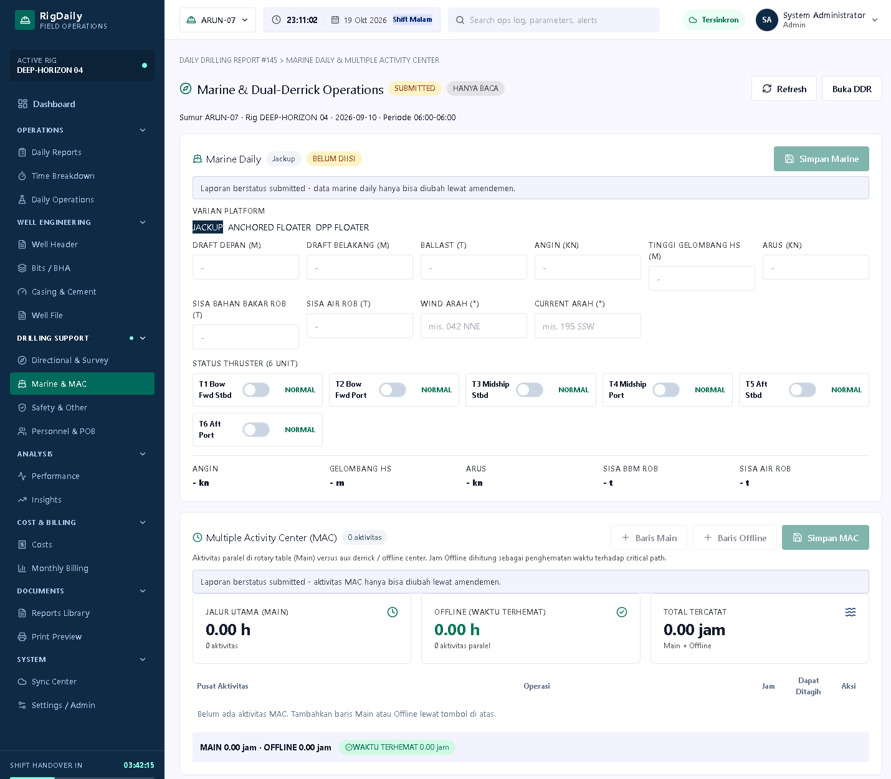

**Marine daily** punya tiga varian form: Jackup, Anchored Floater, dan DPP Floater. Isian mencakup draft depan dan belakang, ballast, kecepatan dan arah angin, tinggi gelombang, arus, status enam thruster, serta sisa bahan bakar dan air tawar.

**Multiple Activity Center** ditujukan untuk rig dengan dua derrick. Tabel memisahkan aktivitas Main dan Offline, menghitung total jam masing-masing, dan menampilkan badge penghematan waktu dari pekerjaan offline seperti penyusunan stand.

#### Personnel & POB

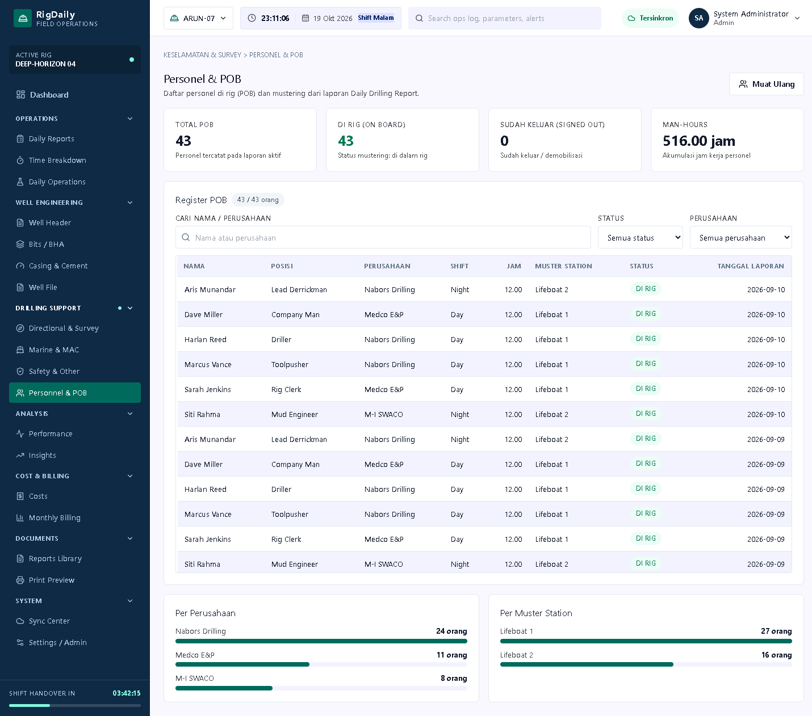

Empat kartu di atas: total POB, jumlah di atas rig, jumlah sudah keluar, dan total man-hours.

Tabel memuat nama, posisi, perusahaan, shift, jam kerja, muster station, status, dan tanggal laporan. Pencarian bekerja pada nama dan perusahaan, dengan filter status dan filter perusahaan.

Dua kartu agregat di bawah memecah jumlah orang per perusahaan dan per muster station.

---

### Analysis

#### Performance

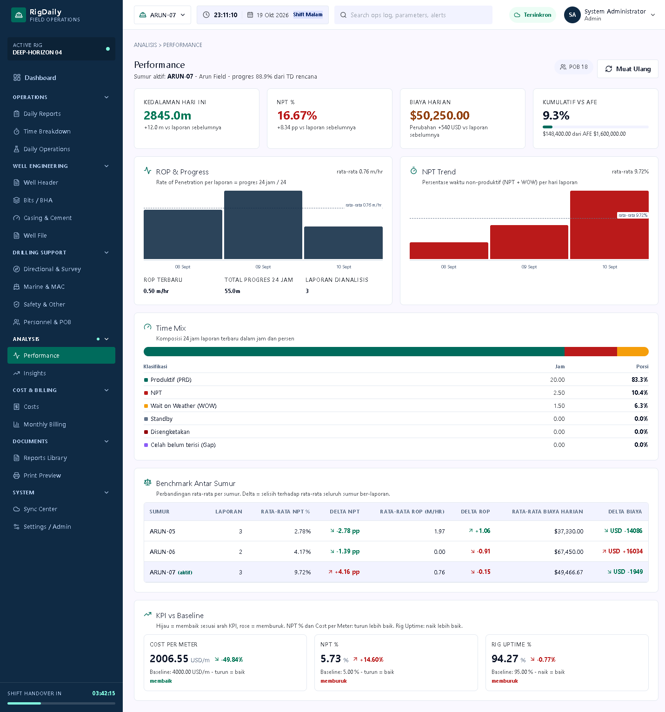

Halaman ini menjawab pertanyaan operasional: seberapa cepat sumur ini dibor, di mana waktu hilang, dan bagaimana posisinya dibanding sumur lain.

- **KPI utama** dari laporan terbaru: kedalaman, NPT, biaya harian, dan kumulatif terhadap AFE.
- **ROP dan progress.** ROP dihitung dari progress 24 jam dibagi 24. Grafik batang menampilkan garis rata-rata.
- **Tren NPT** per tanggal.
- **Komposisi waktu** dalam bilah bertumpuk: produktif, NPT, cuaca, standby, dispute, dan gap.
- **Benchmark antar sumur.** Tabel membandingkan NPT, ROP, dan biaya harian tiap sumur terhadap rata-rata. Selisih ditampilkan hijau bila membaik dan merah bila memburuk. Sumur yang sedang aktif ditandai.
- **KPI terhadap baseline.** Arah warna mengikuti sifat metrik: NPT dan biaya per meter membaik ketika turun, uptime membaik ketika naik.

#### Insights

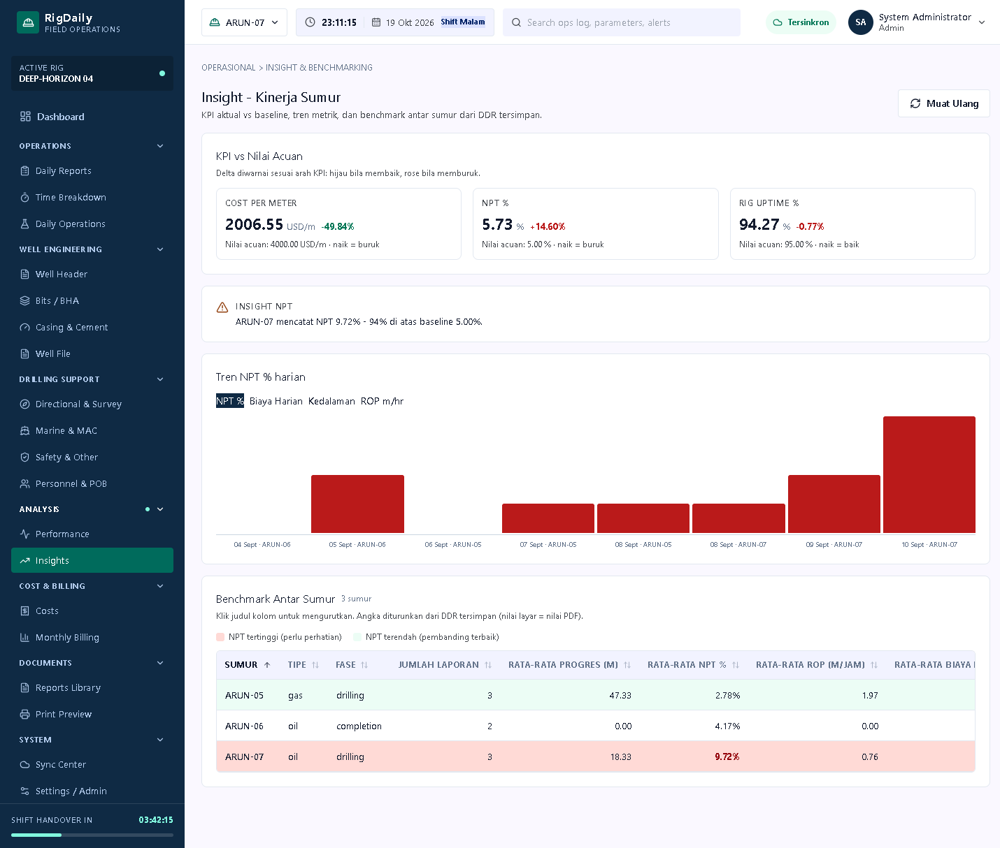

Analitik lintas sumur dengan fokus pada perbandingan.

Pemilih metrik mengubah grafik tren antara NPT, biaya harian, kedalaman, dan ROP. Tabel benchmark bisa diurutkan per kolom. Baris dengan NPT tertinggi berwarna merah, terendah hijau, dengan legenda yang menjelaskan artinya.

Kalimat insight dihasilkan dari angka yang sedang tampil, bukan teks tetap. Contohnya menyebut sumur dengan NPT di atas baseline beserta selisih persennya.

Bila baru ada satu sumur, halaman mengatakannya dan mengarahkan ke impor CSV untuk menambah pembanding.

---

### Cost & Billing

#### Costs

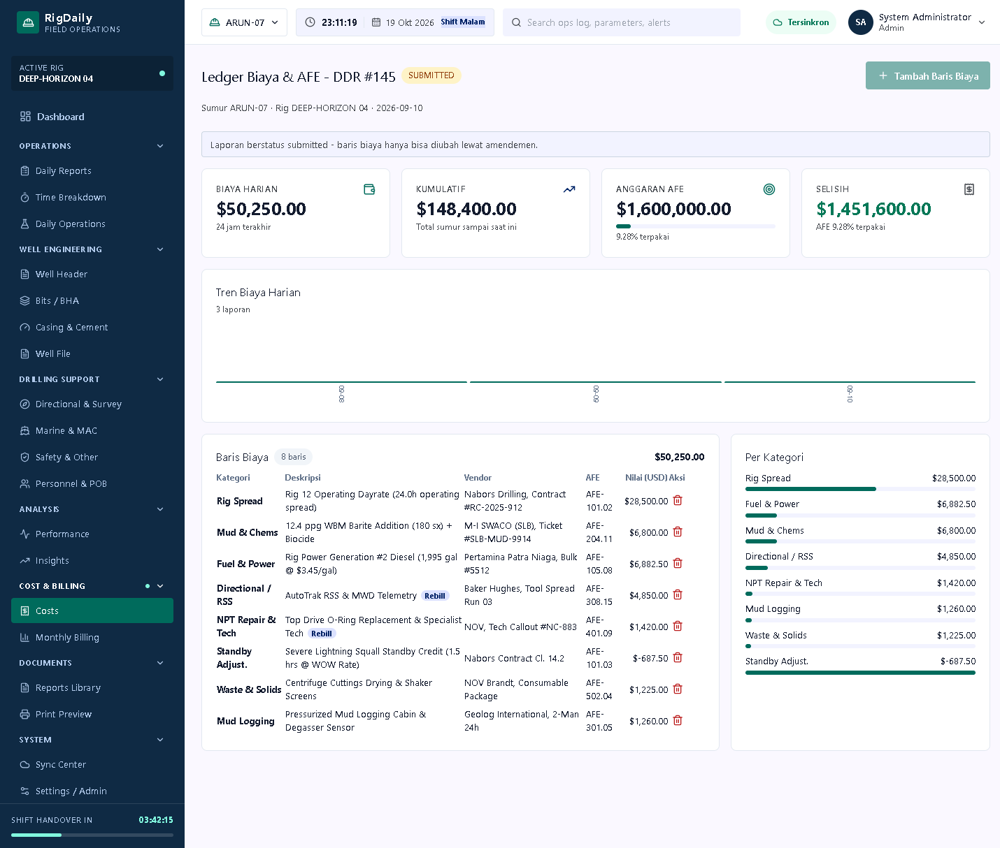

Empat kartu di atas: biaya hari ini, kumulatif, anggaran AFE dengan bilah pemakaian, dan variance.

Tabel baris biaya memuat kategori, deskripsi, vendor, kode AFE, tipe penagihan, nominal, dan penanda rebillable. Nominal negatif dipakai untuk kredit, misalnya potongan standby cuaca. Baris bertanda NPT diberi latar merah muda.

Grafik 14 hari memperlihatkan pola pengeluaran terhadap plafon harian. Di bawahnya ada pemecahan kumulatif per kelompok: rig spread, lumpur, directional, dan NPT.

Menambah baris biaya membuka modal dengan validasi nominal tidak boleh nol. Menghapus baris meminta konfirmasi lebih dulu.

#### Monthly Billing

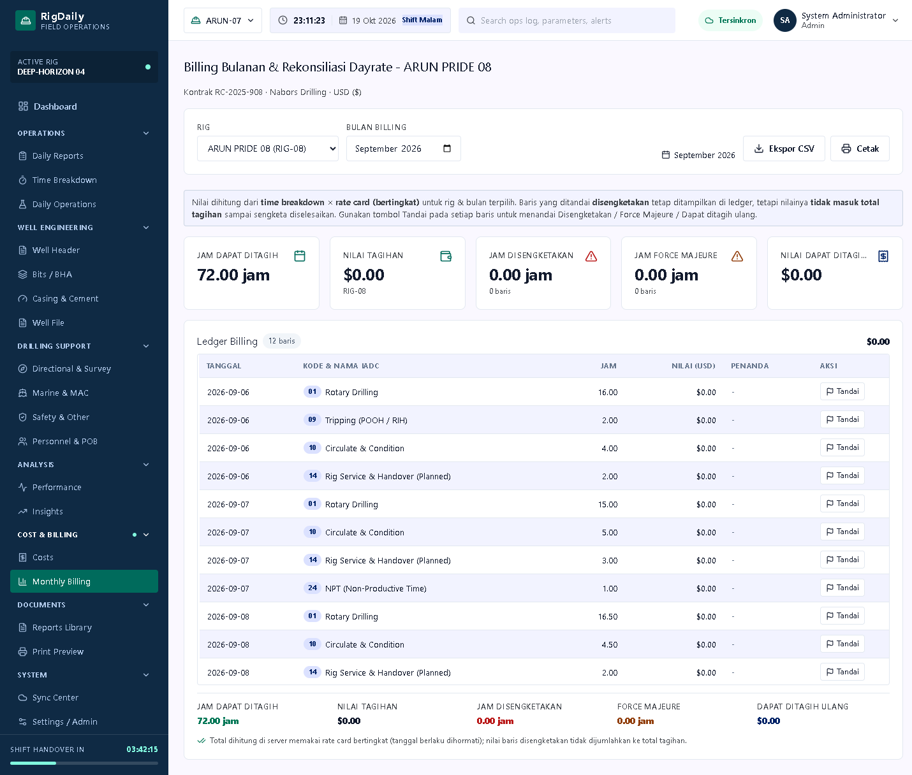

Tagihan bulanan per rig, dihitung dari jam aktivitas dikali rate card bertingkat.

Lima kartu di atas: jam yang bisa ditagih, nominal, jam disputed, jam force majeure, dan nominal rebillable.

Tabel menampilkan tanggal, kode IADC, jam, nominal, dan flag. Baris disputed tetap menampilkan nominalnya tetapi tidak masuk total tagihan sampai sengketa selesai. Baris force majeure dihitung sesuai klausul kontrak.

Kolom aksi membuka editor flag per baris untuk menandai disputed, force majeure, atau rebillable. Setelah disimpan, total langsung dihitung ulang.

Rate card memakai tanggal berlaku, sehingga perubahan tarif tidak mengubah tagihan bulan yang sudah lewat.

---

### Documents

#### Reports Library

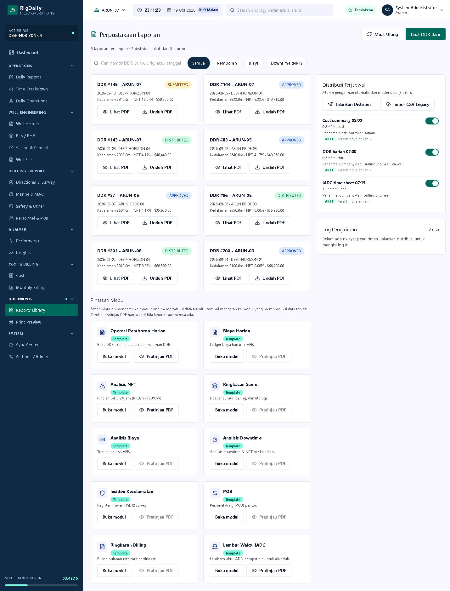

Katalog dokumen dalam satu tempat.

Pencarian dan chip kategori menyaring daftar laporan. Setiap kartu menampilkan nomor DDR, sumur, tanggal, kedalaman, biaya, status, dan dua tombol: lihat PDF serta buka laporan.

Sepuluh pintasan di bawah mengarah ke modul yang menghasilkan data terkait, misalnya Daily Drilling Operations, Daily Costs, NPT Analysis, dan Billing Summary.

Rail kanan memuat jadwal distribusi dengan sakelar aktif dan nonaktif, beserta log pengiriman: penerima, subjek, status, jumlah percobaan, dan pesan galat. Pengiriman yang gagal bisa dikirim ulang dari sini.

Dua tombol operasional ada di bagian ini: **Jalankan Distribusi** untuk memproses antrean email sekarang, dan **Impor CSV Legacy** untuk memasukkan data dari sistem lama.

#### Print Preview

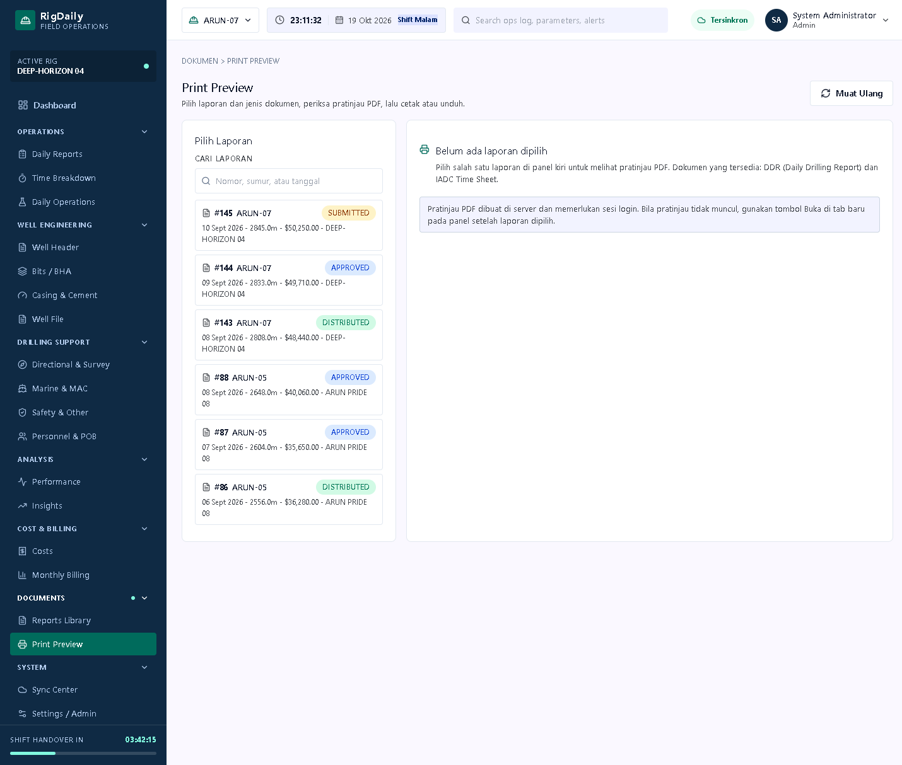

Pilih laporan di panel kiri, pilih jenis dokumen di panel kanan, lalu lihat hasilnya sebelum dicetak.

Dua jenis dokumen tersedia:

- **DDR.** Laporan formal sembilan bagian dengan tanda tangan di akhir.
- **IADC Time Sheet.** Lembar waktu lanskap dengan kolom kode, sub-kode, dan klasifikasi waktu.

PDF tampil langsung di dalam halaman. Tersedia tombol cetak, buka di tab baru, unduh, dan muat ulang pratinjau.

---

### System

#### Sync Center

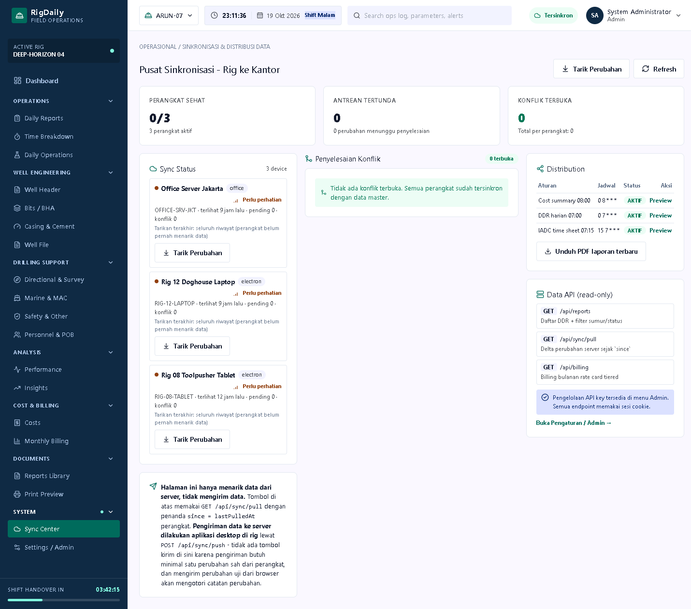

Tiga kolom yang memantau pergerakan data antara rig dan kantor.

**Status perangkat.** Setiap perangkat menampilkan nama, tipe, waktu terakhir terlihat, dan jumlah perubahan tertunda. Indikator tiga warna: hijau saat semua tersinkron, kuning saat ada antrean atau perangkat lama tidak terlihat, merah saat ada konflik.

**Penyelesai konflik.** Saat laporan yang sudah disetujui menerima perubahan dari rig, sistem tidak menimpanya. Konflik muncul di sini dengan tampilan berdampingan antara versi rig dan versi server. Perubahan yang berbeda disorot. Anda memilih mempertahankan versi rig, versi server, atau menggabungkan keduanya.

**Distribusi dan API.** Jadwal pengiriman beserta status aktifnya, dan daftar endpoint yang tersedia untuk integrasi.

#### Admin Console

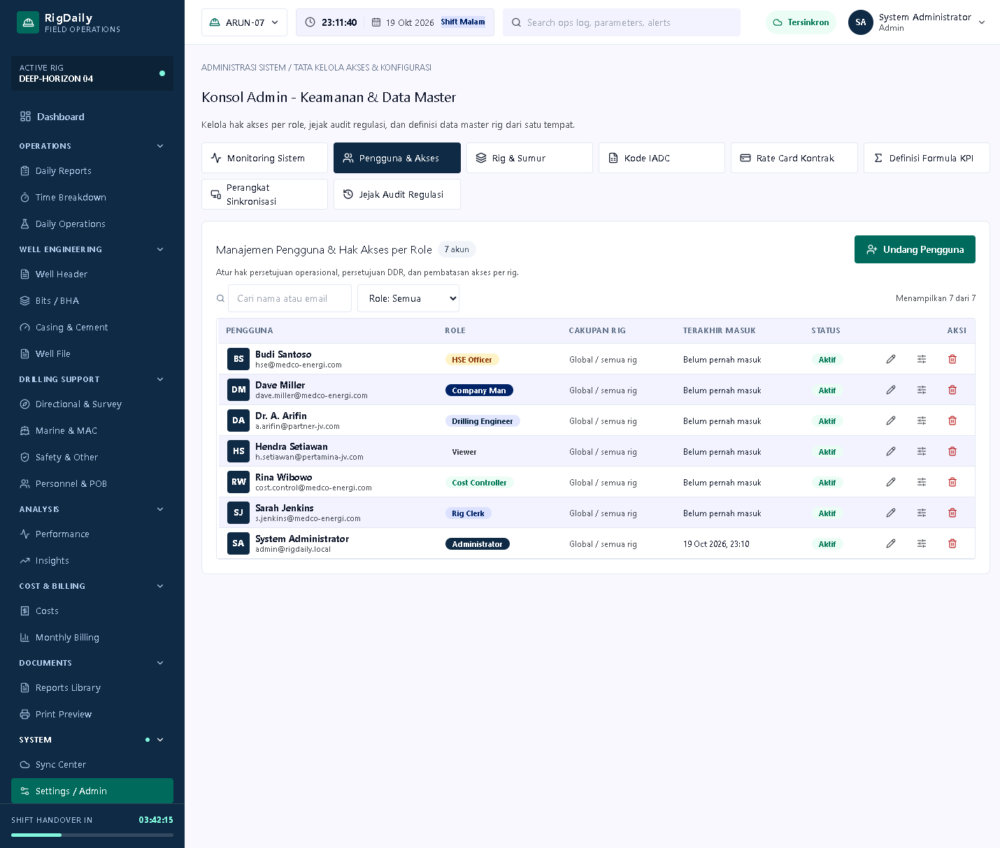

Tujuh domain administrasi dalam satu halaman.

**Monitoring Sistem** menampilkan jumlah sumur, rig, pengguna, DDR, insiden, perangkat, dan rate card, ditambah status database. Ada juga distribusi status laporan, daftar sesi aktif beserta alamat IP, dan sepuluh aktivitas audit terakhir.

**Pengguna dan Akses** mengelola akun: nama, email, peran, cakupan rig, status MFA, login terakhir. Tersedia tambah, edit, nonaktifkan, dan hapus. Sistem menolak menghapus admin terakhir dan menolak pengguna menghapus dirinya sendiri.

**Rig dan Sumur** adalah daftar master dengan tautan ke berkas sumur.

**Kode IADC** berisi 34 kode yang bisa diaktifkan atau dinonaktifkan dan ditandai sebagai NPT.

**Rate Card Kontrak** menyimpan tarif bertingkat per kode aktivitas beserta tanggal berlaku.

**Definisi KPI** menyimpan rumus dan baseline yang dipakai halaman Performance.

**Perangkat Sinkronisasi** mengelola kunci API untuk aplikasi rig. Kunci hanya ditampilkan sekali saat dibuat, lalu disimpan sebagai hash.

**Jejak Audit** mencatat setiap perubahan: waktu, pelaku, entitas, aksi, nilai lama dan baru, alamat IP, dan terminal.

#### Profil & Keamanan

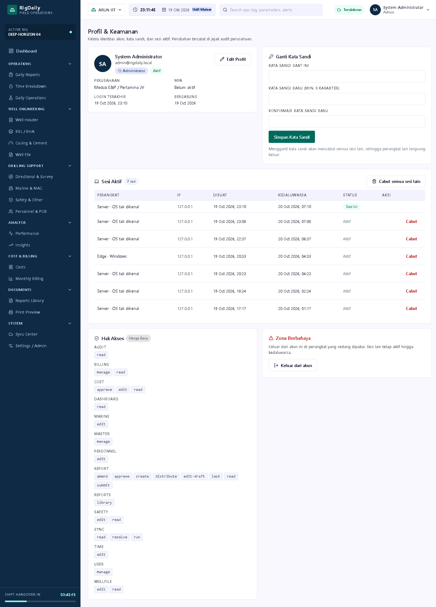

Enam kartu yang mengurus identitas dan akses akun Anda.

**Identitas** menampilkan avatar, nama, email, peran, perusahaan, status akun, login terakhir, dan tanggal bergabung. Nama dan email bisa diubah lewat modal, dengan pemeriksaan email duplikat.

**Ganti kata sandi** meminta sandi lama dan sandi baru dua kali. Indikator kekuatan menghitung panjang dan variasi karakter. Setelah sandi berubah, semua sesi lain dicabut.

**Sesi aktif** menampilkan perangkat yang sedang masuk: peramban, sistem operasi, alamat IP, waktu dibuat, dan waktu kedaluwarsa. Sesi yang sedang dipakai ditandai. Sesi lain bisa dicabut satu per satu atau sekaligus.

**Hak akses** menampilkan seluruh izin yang melekat pada peran Anda, dikelompokkan per bidang.

**Zona keluar** menyediakan tombol keluar dengan konfirmasi.

---

## Cara kerja intinya

Satu hari operasi melewati lima tahap.

```
Rig                          Kantor                        Manajemen
 |                              |                              |
 |- Isi DDR (draft)             |                              |
 |- Validasi 24 jam             |                              |
 |- Kirim untuk persetujuan     |                              |
 |                              |- Company Man menyetujui      |
 |                              |- Tanda tangan digital        |
 |                              |- PDF dibuat otomatis         |
 |                              |- Email terkirim 07:00        |
 |                              |                              |- Dashboard
 |                              |                              |- Benchmark
 |                              |- Biaya masuk billing         |
```

Tiga prinsip yang menjaga sistem tetap konsisten.

**Satu sumber perhitungan.** Semua angka waktu, biaya, dan NPT dihitung oleh fungsi yang sama di `packages/shared`. Layar dan PDF memakai fungsi itu, jadi angkanya tidak mungkin berbeda.

**Laporan final tidak bisa ditimpa.** Setelah disetujui, DDR terkunci. Perubahan hanya lewat amendemen yang membuat revisi bernomor dan menyalin seluruh isi laporan induk.

**Sinkronisasi bersifat idempoten.** Setiap perubahan punya pengenal unik. Mengirim ulang perubahan yang sama tidak menghasilkan data ganda.

---

## Menjalankan di komputer sendiri

### Yang perlu disiapkan

- Node.js 22 atau lebih baru
- Docker Desktop, opsional tetapi disarankan
- Git

### Langkah pertama

```powershell
git clone <url-repositori> rimgaily
cd rimgaily
npm install
```

### Pilih basis data

**Dengan Docker, sama seperti produksi.**

```powershell
docker compose -f infra/docker/compose.dev.yml up -d
```

Perintah ini menyalakan PostgreSQL 16 di port `55432`. Pilihan port itu menghindari bentrok dengan PostgreSQL yang mungkin sudah ada di `5432`.

**Tanpa Docker.**

Biarkan `DATABASE_URL` kosong. Aplikasi otomatis memakai PGlite, yaitu PostgreSQL yang dikompilasi ke WebAssembly dan berjalan di dalam proses Node. Data tersimpan di folder `.pglite-data`.

### Siapkan data

```powershell
npm run db:migrate
npm run db:seed
npm run db:seed:variants
npm run db:seed:engineering
```

### Jalankan

```powershell
npm run dev
```

Buka `http://localhost:3000` dan masuk dengan `admin@rigdaily.local` serta kata sandi `rigdaily123`.

Migrasi berjalan otomatis saat server pengembangan dinyalakan bila tabel belum ada. Bila `.env.local` tidak ditemukan, aplikasi memberi peringatan di konsol dan tetap memakai PGlite agar tidak berhenti mendadak.

---

## Menjalankan di VPS 2 vCPU

Panduan lengkap ada di [`docs/deploy/`](docs/deploy/), yang berisi langkah instalasi, operasi harian, dan penanganan masalah. Ringkasnya:

1. Jalankan `infra/scripts/setup-vps.sh` di VPS. Skrip menyiapkan swap 2 GB, Docker, firewall, dan folder `/opt/rigdaily`.
2. Build image **di komputer Anda**, bukan di VPS. `next build` di mesin 2 vCPU dengan 2 GB RAM akan kehabisan memori di tengah proses.
3. Kirim image dengan `infra/scripts/deploy.ps1`, yang membungkus `docker save`, `scp`, dan `docker load`.
4. Isi `.env` dari `.env.example`. Ganti setiap kata sandi contoh.
5. Jalankan `docker compose -f docker-compose.prod.yml up -d`.
6. Pastikan `GET /api/health` membalas `{ "db": true, "driver": "postgres" }`.

Anggaran memori yang dipakai:

| Layanan | Batas |
|---|---|
| PostgreSQL | 430 MB |
| Aplikasi web | 700 MB |
| Caddy | 120 MB |
| **Total** | **1.25 GB** |

Sisa RAM dipakai sistem operasi dan cache. Tidak ada Redis, MinIO, atau metrik pihak ketiga, karena ketiganya tidak muat di mesin sekecil ini.

Di produksi, `DATABASE_URL` wajib diisi dan `RIGDAILY_DRIVER` harus kosong. Entrypoint container menolak menyala bila masih mengarah ke PGlite, supaya data tidak hilang saat container dibuat ulang.

## Demo publik di Vercel

Untuk memamerkan aplikasi tanpa menyiapkan PostgreSQL, deploy ke Vercel dengan
Root Directory `rimbase-rebuild/apps/web` dan environment variable
`RIGDAILY_DEMO=1` serta `RIGDAILY_DEMO_SECRET`. Aplikasi memakai PGlite
in-memory: schema dan data contoh dibuat otomatis pada request pertama, lalu
hilang saat instance didaur ulang. Halaman login menampilkan tombol masuk cepat
untuk tujuh peran, dan banner di dalam aplikasi menyediakan reset data.

Data mode demo tidak permanen dan tidak dibagi antar instance. Jangan mengisi
`DATABASE_URL` pada mode ini. Root Directory aplikasi adalah `apps/web` di
dalam folder `rimbase-rebuild`, dan dua variabel di atas wajib diisi sebelum
build pertama.

---

## Arsitektur

```
packages/shared      Kontrak domain: 34 kode IADC, perhitungan 24 jam,
                     validasi kedalaman, billing bertingkat, matriks peran,
                     protokol sinkronisasi, skema validasi.
packages/database    Skema Drizzle untuk PostgreSQL, migrasi idempoten,
                     data awal, hashing kata sandi. Driver ganda: PGlite
                     untuk pengembangan, PostgreSQL untuk produksi.
packages/ui          Sistem desain: token warna, tipografi, komponen dasar.
apps/web             Next.js App Router. 22 halaman, lebih dari 60 endpoint.
apps/desktop         Aplikasi Electron untuk rig. SQLite lokal, antrean
                     perubahan, sinkronisasi otomatis.
infra/               Dockerfile, compose produksi, Caddy, skrip cadangan.
tests/               Uji unit dan integrasi.
e2e/                 Uji end to end dengan Playwright.
```

Alur data di aplikasi web:

```
Komponen React
   | useApi (cache dan dedupe)
   v
Route handler Next.js
   | requireUser, requirePermission
   v
Lapisan repository
   | fungsi murni dari packages/shared
   v
PostgreSQL
```

Tidak ada komponen yang menulis angka sendiri. Lapisan repository mengambil data, lalu memanggil fungsi perhitungan di `packages/shared`. Route handler hanya mengurus autentikasi, validasi masukan, dan bentuk respons.

### Efisiensi data

Empat lapis yang membuat perpindahan halaman terasa ringan.

| Lapis | Cara kerja |
|---|---|
| Cache klien | Data disimpan di memori dengan masa berlaku per jenis. Data master 5 sampai 10 menit, data operasional 15 sampai 30 detik. |
| Dedupe | Tiga komponen yang meminta alamat sama hanya memicu satu permintaan jaringan. |
| Stale-while-revalidate | Data lama tampil segera, pembaruan berjalan di latar belakang. Layar tidak berkedip. |
| Prefetch | Saat kursor menyentuh menu, data halaman tujuan mulai diambil. Saat diklik, datanya sudah siap. |

Setiap perubahan data membuang cache yang terkait, sehingga angka lama tidak tertinggal setelah penyimpanan.

Di sisi server, endpoint dashboard menjalankan query secara paralel. Sebelumnya berurutan dalam empat tahap, sehingga total waktu tunggu adalah jumlah seluruh query.

### Keamanan

- Kata sandi di-hash dengan scrypt dari modul kripto bawaan Node. Tidak ada dependensi hashing tambahan.
- Sesi disimpan di tabel dengan hash token. Cookie HttpOnly, SameSite Lax, dan Secure di produksi.
- Validasi sesi dilakukan di server layout, bukan hanya dengan memeriksa keberadaan cookie. Cookie kedaluwarsa dihapus dan pengguna diarahkan ke halaman masuk.
- Setiap respons API dan halaman terlindungi memakai `Cache-Control: no-store`, supaya data satu pengguna tidak tersisa di cache peramban.
- Pemeriksaan izin berlapis: di server layout, di route handler, dan di antarmuka.
- Rate limit lima percobaan masuk per 15 menit untuk setiap kombinasi IP dan email.

---

## Aturan domain yang ditegakkan

**Waktu tepat 24 jam.** Time breakdown harus berjumlah 1440 menit sebelum laporan bisa dikirim. Baris yang tumpang tindih, celah waktu, atau kode tanpa sub-kode ditolak dengan daftar masalah per baris.

**Kedalaman tidak mundur.** Kedalaman akhir tidak boleh lebih kecil dari kedalaman awal. Kedalaman awal juga harus menyambung dengan laporan sebelumnya.

**Status berjenjang.** Draft, submitted, approved, distributed, locked. Setelah approved, laporan terkunci dan perubahan hanya lewat amendemen.

**Amendemen menyalin seluruh isi.** Revisi baru membawa time rows, crew, mud, BHA, directional survey, MAC, dan baris biaya dari laporan induk.

**Biaya kumulatif dihitung sekali per tanggal.** Revisi pada tanggal yang sama tidak menambah total kumulatif.

**Sinkronisasi tidak menimpa laporan terkunci.** Konflik pada laporan approved masuk antrean penyelesaian manual dengan pilihan mempertahankan versi rig, versi server, atau gabungan.

**Billing bertingkat tanpa menagih celah.** Perhitungan tarif bertingkat tidak menagih jam yang jatuh di antara dua tingkat tarif. Baris disputed tidak masuk total tagihan.

**Rate card mengikuti tanggal berlaku.** Perubahan tarif tidak mengubah tagihan bulan yang sudah berjalan.

**Semua perubahan tercatat.** Setiap mutasi menulis baris audit dengan pelaku, aksi, nilai lama, nilai baru, alamat IP, dan terminal.

---

## Peran dan hak akses

| Peran | Cakupan | Yang bisa dilakukan |
|---|---|---|
| Rig Clerk | Rig sendiri | Membuat dan mengedit draft DDR, mengisi time breakdown, data kru, marine, safety |
| Company Man | Rig yang ditugaskan | Menyetujui, menandatangani, mengunci, dan mendistribusikan laporan |
| Drilling Engineer | Lintas sumur | Validasi lintas sumur, koreksi lewat amendemen, mengelola data sumur |
| Cost Controller | Biaya dan billing | Mengisi dan menyetujui biaya, mengelola rate card dan billing |
| HSE Officer | Keselamatan | Mencatat dan menindaklanjuti insiden |
| Viewer | Hanya baca | Melihat dashboard dan PDF |
| Administrator | Seluruh sistem | Semua izin, termasuk pengguna, master data, dan penyelesaian konflik |

Izin bersifat granular, 28 jenis. Matriks lengkapnya ada di `packages/shared/src/roles.ts`. Antarmuka menyembunyikan tombol yang tidak boleh dipakai, tetapi penegakan sebenarnya tetap di server.

---

## Perintah yang tersedia

| Perintah | Kegunaan |
|---|---|
| `npm run dev` | Server pengembangan dengan migrasi otomatis |
| `npm run build` | Build produksi |
| `npm start` | Menjalankan hasil build |
| `npm test` | 360 uji unit dan integrasi |
| `npm run e2e` | Uji end to end dengan Playwright |
| `npm run typecheck` | Pemeriksaan tipe TypeScript |
| `npm run verify` | Typecheck, uji, lalu build |
| `npm run db:migrate` | Membuat atau memperbarui skema |
| `npm run db:seed` | Data demo utama |
| `npm run db:seed:variants` | Laporan tambahan untuk tiga sumur |
| `npm run db:seed:engineering` | Data bit, casing, dan semen |
| `npm run audit:text` | Memeriksa karakter rusak dan tipografi |
| `npm run audit:text:fix` | Memperbaiki temuan secara otomatis |
| `npm run pg:up` | Menyalakan PostgreSQL pengembangan |
| `npm run pg:down` | Mematikan PostgreSQL pengembangan |

---

## Data demo

Tiga sumur dengan karakter berbeda, supaya setiap fitur punya sesuatu untuk ditampilkan.

| Sumur | WELL ID | Division | Karakter | DDR | Bit | Casing | Semen |
|---|---|---|---|---|---|---|---|
| ARUN-07 | ARN-07-DEV | Sumatera Operations | Sumur bermasalah, NPT tinggi | 4 | 5 | 4 | 3 |
| ARUN-05 | ARN-05-EXP | Sumatera Operations | Sumur efisien, NPT rendah | 3 | 3 | 4 | 3 |
| ARUN-06 | ARN-06-DEV | North Aceh Development | Fase completion, biaya tinggi | 2 | 2 | 4 | 4 |

ARUN-07 mencatat NPT sekitar 11 persen dengan satu insiden. ARUN-05 mencatat NPT sekitar 3 persen tanpa insiden. ARUN-06 sudah mencapai TD dan masuk fase completion dengan job squeeze yang masih berstatus rencana.

Selain tiga sumur, data awal mencakup tujuh pengguna, sebelas rate card, tiga aturan distribusi, tiga perangkat sinkronisasi, dan empat definisi KPI.

Akun demo:

| Email | Peran |
|---|---|
| `admin@rigdaily.local` | Administrator |
| `dave.miller@medco-energi.com` | Company Man |
| `s.jenkins@medco-energi.com` | Rig Clerk |
| `a.arifin@partner-jv.com` | Drilling Engineer |
| `cost.control@medco-energi.com` | Cost Controller |
| `hse@medco-energi.com` | HSE Officer |
| `h.setiawan@pertamina-jv.com` | Viewer |

Semua memakai kata sandi yang sama, `rigdaily123`. Ganti sebelum dipakai di lingkungan nyata.

---

## Struktur repositori

```
rimgaily/
  apps/
    web/
      app/
        (auth)/          login, layout yang memvalidasi sesi
        (app)/           dashboard, ddr, time, well-header, bits,
                         casing-cement, well-file, daily-ops,
                         safety-survey, marine-mac, personnel,
                         performance, insights, cost, billing,
                         reports, print, sync, admin, profile
        api/             auth, wells, reports, sync, master,
                         admin, system, insights, billing
      components/        table, panel, editor, diagram, menu
      lib/               cache, autentikasi, repositori, perhitungan
  packages/
    shared/              34 kode IADC, perhitungan, validasi, peran, skema
    database/            skema Drizzle, migrasi, data awal
    ui/                  token desain, komponen dasar
  apps/desktop/          aplikasi Electron
  infra/                 Docker, Caddy, skrip cadangan, SQL
  tests/                 uji unit dan integrasi
  e2e/                   uji Playwright
  docs/
    screenshots/         tangkapan layar untuk README
    deploy/              panduan deployment, runbook, troubleshooting
```

---

## Pengujian

```
npm test              360 uji lolos
npm run e2e           73 uji end to end
npm run typecheck     tidak ada kesalahan tipe
npm run audit:text    tidak ada karakter rusak
```

Cakupan uji utama:

| Berkas | Yang diuji |
|---|---|
| `calc-time` | Konversi waktu, durasi lintas tengah malam, total 24 jam, overlap, celah, kode tidak dikenal |
| `calc-depth` | Kedalaman mundur, rantai antar laporan, progress tidak wajar |
| `calc-billing` | Tarif bertingkat, celah antar tingkat, force majeure, dispute, rebillable |
| `calc-cost` | Agregasi biaya, pemakaian AFE, sisa anggaran |
| `iadc` | Keutuhan 34 kode, klasifikasi waktu per kode |
| `roles` | Matriks izin per peran, tidak ada duplikat |
| `sync-protocol` | Hash payload, backoff, aturan konflik, indikator status |
| `repo-*` | Integrasi dengan basis data sungguhan: laporan, dashboard, billing |
| `schema` | Idempotensi migrasi, kelengkapan tabel |

Uji end to end mencakup alur masuk, proteksi rute, dashboard, DDR, time breakdown, biaya, billing, laporan, sinkronisasi, admin, POB, insights, profil, serta konsistensi angka antar modul.

---

## Lisensi

Hak cipta (c) 2026 PogungSoftwareHouseTeam (PSHT). Seluruh hak dilindungi.

Kode dalam repositori ini dikembangkan dan dimiliki oleh PogungSoftwareHouseTeam (PSHT). Detail ketentuan penggunaan ada di [LICENSE.md](LICENSE.md).

Dependensi pihak ketiga tunduk pada lisensi masing-masing, bukan pada lisensi ini.
